<!-- 이 파일은 비공개 설정 저장소의 Actions가 만듭니다. 여기서 고치면 다음 빌드에 덮어씁니다. -->

### 만들고 있는 것들

설계부터 배포까지 혼자 맡아 만드는 웹 서비스, 게임, 개발 도구를 모았습니다. 서비스는 대부분 Cloudflare 무료 구성(Pages·Workers·D1)으로 운영합니다.

#### 이렇게 만듭니다

- **AI와 함께, 여러 갈래로 동시에.** Claude Code 세션을 기능마다 나눠 띄우고, 통합 세션이 결과를 모아 병합과 배포를 맡습니다. 휴대폰에서도 진행 상황을 보고 다음 일을 맡깁니다. 최근 30일 동안 저장소 9곳에서 PR 685개를 이렇게 병합했습니다.
- **설계 문서부터, 다른 AI의 검토를 거쳐.** 기능마다 설계와 구현 계획을 문서로 먼저 쓰고, Codex 같은 다른 모델이 짚은 문제를 반영한 뒤에 구현합니다. 기출문항 추출처럼 틀리면 안 되는 일은 두 모델이 따로 만든 결과를 대조합니다.
- **한 번 만들어 같이 쓰기.** 여러 서비스에 필요한 로그인·기기 세션, 카카오 공유, UI 부품, 색 팔레트는 공용 패키지로 만들어 GitHub Packages에 발행하고, 서비스마다 버전을 골라 씁니다. 색 팔레트 10종은 한 번 만들어 앱 다섯 곳에 같은 날 넣었습니다.
- **필요한 도구는 직접.** 리뷰 지적을 싼 모델 둘에게 고치게 하는 cascade-fix, 문서 색인 doclookup, 게임 50장을 혼자 끝까지 깨 보는 규칙 AI, 기출문항 검수 파이프라인처럼 개발하며 되풀이되는 일은 도구로 만듭니다. Claude Code 플러그인은 마켓플레이스 저장소 하나에 모아 공개합니다.
- **기계가 확인하고, 사람은 눈으로 볼 것만.** 테스트·타입 검사·빌드·CI를 통과해야 병합하고, 화면을 직접 봐야 하는 것만 확인 목록으로 남깁니다. 새 기능에는 써 볼 날짜를 정해 두고, 그때까지 쓰지 않은 것은 걷어냅니다.

#### 프로젝트

프로젝트 14개 · 운영 중인 사이트 4개 · 마지막 업데이트 2026.11.21

<a href="https://gazua.sch0718.dev"><picture><source media="(prefers-color-scheme: dark)" srcset="cards/gazua-dark-2098b65c.svg">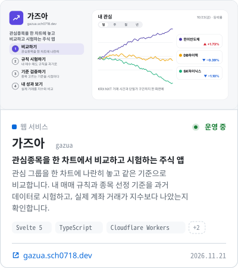</picture></a>
<a href="https://landmark.sch0718.dev"><picture><source media="(prefers-color-scheme: dark)" srcset="cards/landmark-dark-312c2b06.svg"></picture></a>
<a href="https://repass.sch0718.dev"><picture><source media="(prefers-color-scheme: dark)" srcset="cards/repass-dark-96088a32.svg">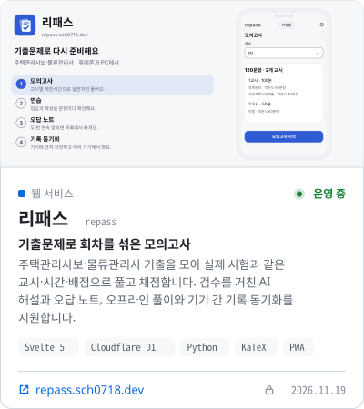</picture></a>
<a href="https://belorn.sch0718.dev"><picture><source media="(prefers-color-scheme: dark)" srcset="cards/belorn-dark-aebbede9.svg"></picture></a>
<a href="https://github.com/sch0718/claude-plugins"><picture><source media="(prefers-color-scheme: dark)" srcset="cards/claude-plugins-dark-45406732.svg">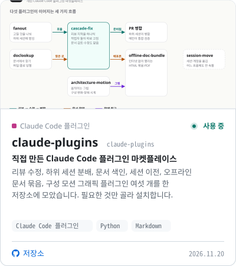</picture></a>
<a href="https://github.com/sch0718/claude-plugins/tree/HEAD/plugins/cascade-fix"><picture><source media="(prefers-color-scheme: dark)" srcset="cards/cascade-fix-dark-f0254b72.svg">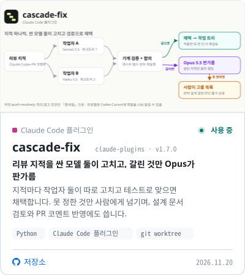</picture></a>
<a href="https://github.com/sch0718/claude-plugins/tree/HEAD/plugins/fanout"><picture><source media="(prefers-color-scheme: dark)" srcset="cards/fanout-dark-7f27d9f8.svg">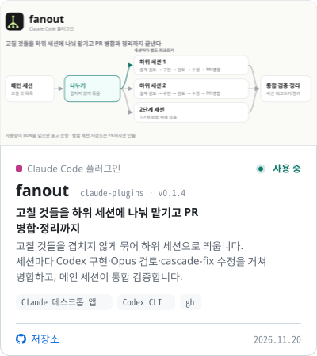</picture></a>
<a href="https://github.com/sch0718/claude-plugins/tree/HEAD/plugins/doclookup"><picture><source media="(prefers-color-scheme: dark)" srcset="cards/doclookup-dark-a934dfdb.svg">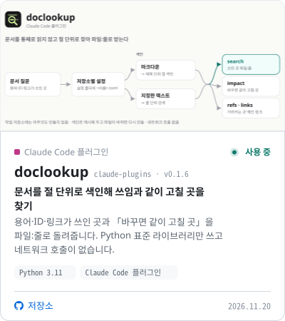</picture></a>
<a href="https://github.com/sch0718/claude-plugins/tree/HEAD/plugins/session-move"><picture><source media="(prefers-color-scheme: dark)" srcset="cards/session-move-dark-3ca373e9.svg">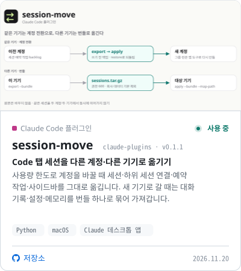</picture></a>
<a href="https://github.com/sch0718/claude-plugins/tree/HEAD/plugins/offline-doc-bundle"><picture><source media="(prefers-color-scheme: dark)" srcset="cards/offline-doc-bundle-dark-ad058bfd.svg">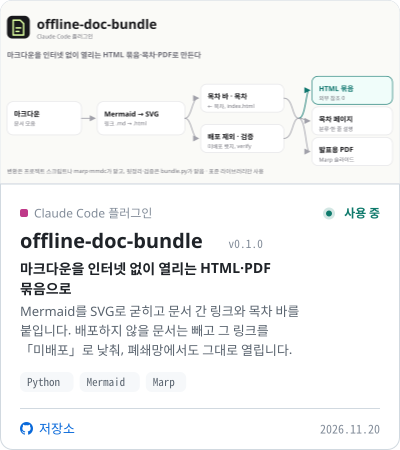</picture></a>
<a href="https://github.com/sch0718/claude-plugins/tree/HEAD/plugins/architecture-motion"><picture><source media="(prefers-color-scheme: dark)" srcset="cards/architecture-motion-dark-99d42bb5.svg">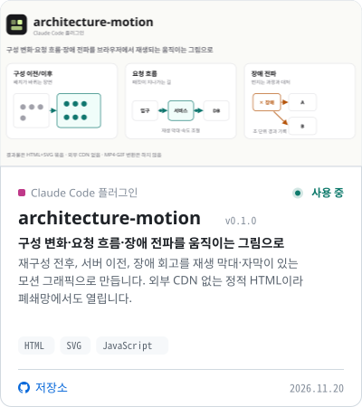</picture></a>
<a href="https://github.com/sch0718/sch0718-toolkit-web"><picture><source media="(prefers-color-scheme: dark)" srcset="cards/sch0718-toolkit-web-dark-6c670a45.svg">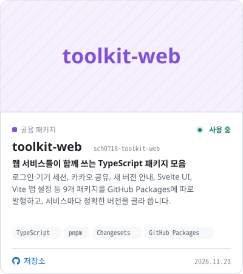</picture></a>
<a href="https://github.com/sch0718/sch0718-toolkit-python"><picture><source media="(prefers-color-scheme: dark)" srcset="cards/sch0718-toolkit-python-dark-a623c1d2.svg">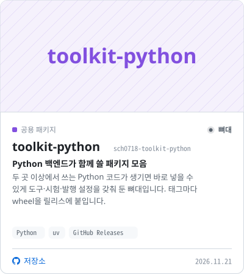</picture></a>
<picture><source media="(prefers-color-scheme: dark)" srcset="cards/smarthome-dark-e534e101.svg"></picture>

